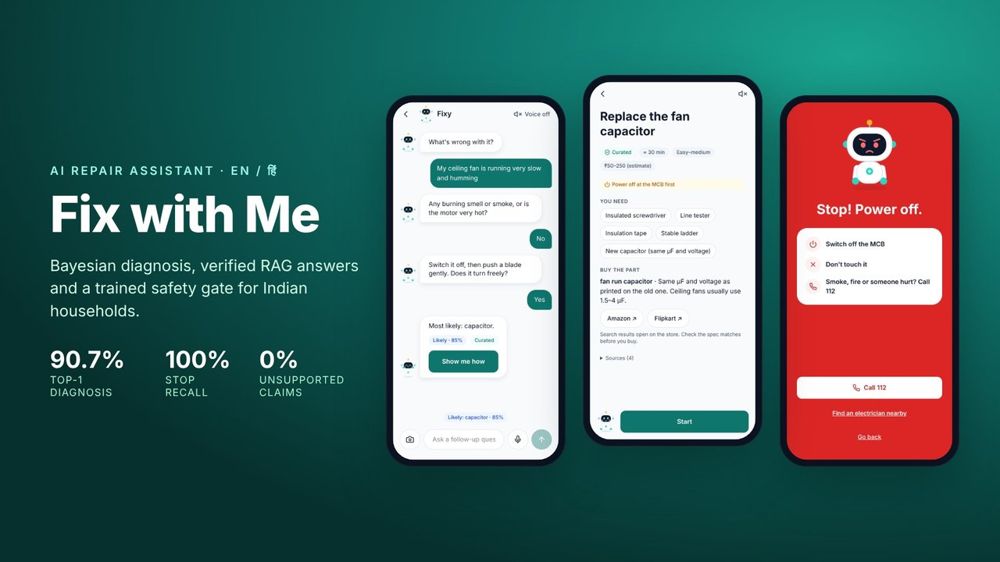

# Aviraj Virape — Portfolio

> *"I don't wait for the future. I build it."*

Personal portfolio of **Aviraj Virape**, a final-year AI & Data Science student (CGPA 9.28) who builds end-to-end machine learning and LLM systems: EDA, scikit-learn / XGBoost models, verified RAG, safety classifiers and deployed apps. Built from scratch with vanilla HTML, CSS, and JavaScript.

**Live:** [aviraj1805.github.io/portfolio](https://aviraj1805.github.io/portfolio/)

---

## What's Inside

| Section | Description |
|---|---|
| **Hero** | Intro with animated ID card and role typewriter |
| **About** | Background, education, and key stats (CGPA, LeetCode, live apps) |
| **Arsenal** | Skills across Foundations, Data Science, AI & ML (including RAG, LLMs and LLM evaluation), and Tools |
| **Missions** | Five featured live apps, led by Fix with Me and MahaGuru AI, plus a grid of six more projects (two with hosted dashboards) |
| **Journey** | MahaGuru AI (COEP I2I startup, ~150 student users, then an open-source rebuild that is live today), internship (Innovexis), and INMEC-2026 research |
| **Contact** | Email, LinkedIn, GitHub, LeetCode, Instagram |

---

## Projects

### Fix with Me — AI repair assistant for Indian households (flagship)


Diagnoses household faults in English, Hindi and Hinglish from text, voice or a photo, then walks the user through a safe, sourced fix or stops the session when a professional is needed.

| Component | Result |
|---|---|
| Bayesian diagnosis engine over a curated knowledge base | 90.7% top-1, 96.0% top-3 on FixBench-IN (94 cases); plain Gemini 81.3% |
| Hybrid RAG on Supabase (pgvector + PGroonga, Reciprocal Rank Fusion) with per-claim Gemma verification | 100% recall@5; 92.5% correct answers and 0% unsupported claims (plain Gemini 87.5% and 34%) |
| TF-IDF + logistic regression safety classifier (3.8K examples, 0.68 MB pure-Python runtime, about 0.2 ms per message) | Hazard recall 67.2% to 89.1%; safety-stop recall 100% (plain Gemini 84.6%), 0% false stops |
| FastAPI + Docker on Render, Next.js PWA on Cloudflare Workers | CI with ruff, 118 pytest tests and a benchmark safety gate |

[Live demo](https://fixwithme.avirajvirape601.workers.dev) · [Source](https://github.com/aviraj1805/FixWithMe) · [Benchmark report](https://github.com/aviraj1805/FixWithMe/blob/main/eval/reports/fixbench-v1-2026-10-24.md) · [Safety model card](https://github.com/aviraj1805/FixWithMe/blob/main/ml/safety_classifier/README.md)
`Python` `FastAPI` `Gemini` `Gemma` `RAG` `Supabase` `scikit-learn` `Next.js` `Docker`

### MahaGuru AI — AI mentor and personalised classroom
An open-source platform for college students with two products. **StudentGPT** is a reflective mentor that asks before it advises, with English and Hinglish safety screening on every message. **Classroom** turns a goal into a diagnostic, a personalised roadmap, generated lessons with an AI teacher, quizzes and adaptive mastery tracking. FastAPI and React monorepo, streamed replies, provider-agnostic LLM layer, one Docker image, CI with end-to-end tests.
[Live demo](https://mahaguru-ai.onrender.com) · [Source](https://github.com/aviraj1805/MahaGuru-V1) · [Research](https://mahaguru-ai.onrender.com/research) · [CI](https://github.com/aviraj1805/MahaGuru-V1/actions/workflows/ci.yml)
`FastAPI` `React` `TypeScript` `PostgreSQL` `Gemini` `Docker` `Playwright`

### Customer Churn Prediction — Kaggle Playground S6E3
XGBoost and LightGBM on ~594K telecom records with 5-fold stratified CV; XGBoost reached 0.916 mean ROC-AUC.
[Live demo](https://churn-predictor-aviraj.onrender.com/) · [Source](https://github.com/aviraj1805/Customer-Churn-Prediction)
`Python` `XGBoost` `LightGBM` `scikit-learn` `Pandas` `Seaborn`

### CreditWise — Loan Approval Prediction
Class-balanced Random Forest in a scikit-learn pipeline: 0.91 F1 and 0.98 ROC-AUC, deployed as a Streamlit app with confidence scores and feature importance.
[Live demo](https://creditwiseloanapprovall.streamlit.app/) · [Source](https://github.com/aviraj1805/CreditWise-Loan-Approval-System)
`Python` `scikit-learn` `Pandas` `NumPy` `Streamlit`

### IAMARS — Drone Detection and Tracking
YOLOv8n fine-tuned on VisioDECT (0.965 mAP@0.5 on a 1,800-image held-out set), ByteTrack tracking, 88.5 FPS on an RTX 2050.
[Live demo](https://huggingface.co/spaces/AvirajV/iamars-drone-tracking) · [Source](https://github.com/aviraj1805/intelligent-aerial-monitoring)
`Python` `YOLOv8` `ByteTrack` `OpenCV` `NumPy`

### More projects
| Project | Highlights | Links |
|---|---|---|
| PhonePe Pulse Insights | 2018–2024 Pulse data → 9-table MySQL, 10 SQL business queries, Streamlit + Plotly | [Live charts](https://aviraj1805.github.io/portfolio/demos/phonepe/) · [Source](https://github.com/aviraj1805/PhonePe) |
| Mental Health in Tech — EDA | 1,251 survey responses, interactive Plotly dashboard | [Live dashboard](https://aviraj1805.github.io/portfolio/demos/mental-health/) · [Source](https://github.com/aviraj1805/mental-health-survey-eda) |
| Tesla Stock Price Forecasting | SimpleRNN vs LSTM, 1/5/10-day horizons; SimpleRNN 3.1% MAPE (1 day) | [Source](https://github.com/aviraj1805/Tesla-Stock-Price-Prediction) |
| SmartCart Customer Segmentation | 2,240 customers, PCA (84.5% variance), 4 Ward clusters | [Source](https://github.com/aviraj1805/Smartcart-Customer-Clustering) |
| Off-road Scene Segmentation | YOLO Hackathon 2026, DINOv2 + ConvNeXt head, 0.432 mIoU | [Source](https://github.com/aviraj1805/yolo_hackathon_MIT) |
| Used Car Price Prediction | Random Forest R² 0.962 vs Linear Regression 0.849 | [Source](https://github.com/aviraj1805/Car-Price-Prediction) |

---

## Tech Stack

Built with **zero frameworks** — pure HTML, CSS, and vanilla JS. Deployed on **GitHub Pages**.

---

## Run Locally

```bash
git clone https://github.com/aviraj1805/portfolio.git
cd portfolio
# open index.html in your browser
```

No build step. No dependencies. Just open `index.html`.

`assets/Aviraj_Virape_Resume.pdf` is the resume linked from the site.

`demos/` holds hosted copies of the PhonePe and Mental Health dashboards; they share one local Plotly bundle (`demos/plotly.min.js`).

---

## Connect

- Email — [virapeaviraj@gmail.com](mailto:virapeaviraj@gmail.com)
- LinkedIn — [/in/avirajvirape](https://www.linkedin.com/in/avirajvirape/)
- GitHub — [/aviraj1805](https://github.com/aviraj1805)
- LeetCode — [/aviraj_virape](https://leetcode.com/u/aviraj_virape/)

---

© 2026 Aviraj Virape.
